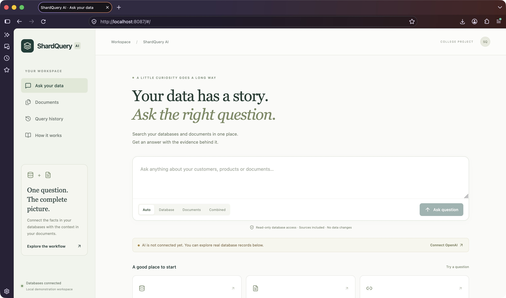
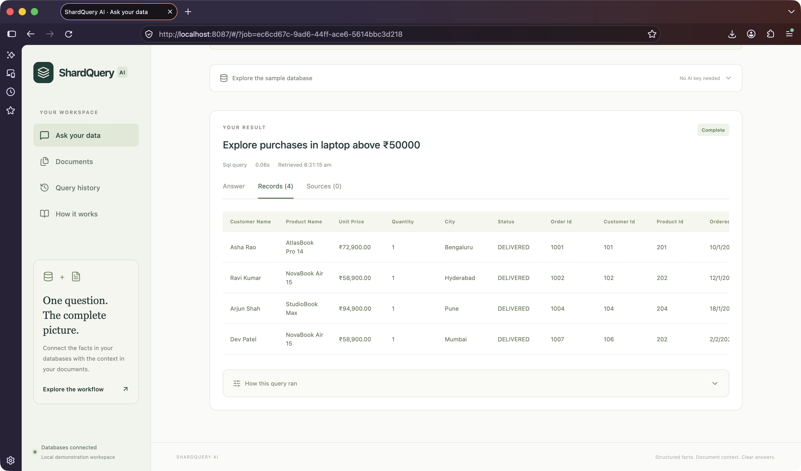
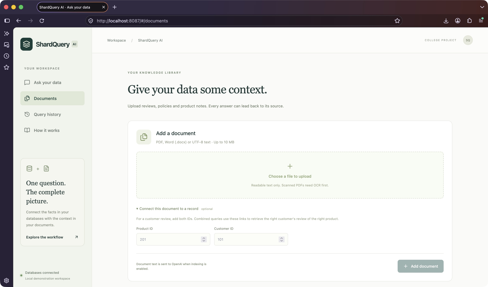

# ShardQuery AI — Final-year project report

**AI-Powered Distributed Database Query Engine with Hybrid SQL + RAG**

Implementation edition: 8 November 2026. This report describes the source delivered with this folder. Add your institution, department, student details and supervisor to your submission cover page.

**Provider update:** The application now uses Google Gemini's free-tier-compatible models at the user's request, replacing the original OpenAI provider. The rest of the architecture is unchanged. See [Free Gemini setup](09-FREE-GEMINI-SETUP.md) and the latest [verification addendum](VERIFICATION.md). Historical test results below describe the initial implementation; the final suite has 32 passing tests, followed by actual Gemini SQL, document indexing, RAG and hybrid checks on the development computer. A new installation needs its own personal key.

## Abstract

Organizations often store transaction facts in relational databases while explanatory material remains in documents. Finding a useful answer requires identifying the relevant records, locating supporting text and preserving their relationship. ShardQuery AI demonstrates a unified query interface over three independent PostgreSQL databases and a document collection. A Java 21 Spring Boot application validates a constrained natural-language query plan, routes read-only queries, associates their results, retrieves relevant document excerpts from Qdrant and requests an evidence-based answer from Gemini. Kafka coordinates document ingestion; Redis accelerates repeated complete queries. A React JavaScript interface exposes answers, records, excerpts, execution details and history. The implementation emphasizes explainability, bounded execution and honest failure reporting. It is a local educational distributed-query system, not a production distributed database cluster.

## Introduction and problem statement

Consider a shop with separate customer, order and product databases. A question such as “Who purchased a laptop above ₹50,000, and what did they say about it?” requires more than a search box. The application must use purchase prices rather than current catalogue prices, exclude cancelled orders, identify the correct customer and product, and retrieve only reviews associated with those records. A similar document belonging to another customer is not valid supporting evidence.

The problem is to make this process understandable to a non-SQL user while keeping database access safe and showing where the answer came from. The project uses a small fictional dataset so every match can be inspected during a viva.

## Existing approaches and their limitations

| Approach | Useful capability | Gap addressed by this project |
| --- | --- | --- |
| SQL client | Precise structured queries | Requires SQL knowledge and manual work across independent databases |
| Document keyword search | Finds explicit words | Does not associate passages with actual purchase records |
| Standalone document RAG | Finds semantically similar passages | Similarity alone does not establish customer/product identity |
| Unrestricted text-to-SQL | Flexible language interface | Requires strong controls before executing generated statements |
| Full distributed SQL infrastructure | Coordinated database operations | Too much operational complexity for this bounded student demonstration |

These are design comparisons, not measured claims about named commercial products.

## Proposed system and objectives

1. Provide one simple question interface for SQL, document and combined queries.
2. Validate model-produced plans against a limited set of supported operations.
3. Route requests to separate PostgreSQL connections and demonstrate customer hash-bucket selection.
4. Associate cross-database records without fabricating missing attributes.
5. Index PDF, DOCX and TXT documents asynchronously and preserve source references.
6. Restrict hybrid retrieval to the matching record associations.
7. Preserve query history and explain partial, failed and cached results.
8. Supply reproducible source, setup instructions, tests and diagrams.

## Requirements and development environment

The complete acceptance criteria are in [Requirements](00-REQUIREMENTS.md). Docker is the simplest runtime requirement. Recommended resources are 16 GB system RAM, four CPU cores and 6 GB allocated to Docker. Native development additionally uses Java 21, Maven 3.9+, Node.js 22.12+ and npm.

| Layer | Implementation |
| --- | --- |
| Frontend | React JavaScript, Vite, Tailwind, Lucide, Axios, React Router |
| Backend | Java 21, Spring Boot 3.5.16, Spring Web/Validation/JDBC/JPA/Kafka/Redis |
| Structured persistence | Three PostgreSQL 16 instances |
| Documents | PDFBox, Apache POI, UTF-8 TXT extraction |
| AI | Gemini OpenAI-compatible REST with strict JSON output and embeddings |
| Retrieval | Qdrant cosine similarity plus metadata filters |
| Background ingestion | Kafka, durable pending document records |
| Cache | Redis with bounded lifetimes |
| Testing | JUnit 5, Mockito, real-service integration tests, Postman |
| Deployment | One application container and six infrastructure containers in Docker Compose |

No separate Python service, microservices, Kubernetes, vector orchestration framework or additional database is introduced.

## System design

The [architecture guide](01-ARCHITECTURE.md) describes the modular monolith. The [UML and workflow document](UML-AND-WORKFLOWS.md) includes 17 diagrams covering components, deployment, use cases, classes, ER models, query/ingestion sequences, state transitions, hash routing, account workflows, database management and external connections. Editable Mermaid sources are in [diagrams](diagrams/).

The web layer validates and schedules requests. QueryService maintains durable jobs and bounded worker execution. OpenAiGateway handles provider calls. SqlEngine compiles approved parameterized templates and assembles bounded results. DocumentService coordinates ingestion. VectorStore handles Qdrant storage and retrieval. Infrastructure modules contain independent shard pools, cache and Kafka settings.

### Database design

Customer profiles and addresses belong to `shard_customer_db`; orders, items and payments belong to `shard_order_db`; products, inventory and structured reviews belong to `shard_product_db`. The product instance also hosts the application's document and job metadata in its `app` schema. Local foreign keys are enforced inside each database. Cross-database associations are logical references assembled in Java.

The three databases are domain partitions. Within the customer and order databases, positive 32-bit customer identifiers select one of three logical partitions using `customer_id % 3`. These logical buckets do not represent additional database servers. Explicit predicates demonstrate partition pruning. Read the [schema and privileges guide](02-DATABASE.md) before describing the design as “sharding” in a presentation.

### Query algorithm

1. Validate question length, mode and explicit filter bounds.
2. Persist a query job and return its identifier with HTTP 202.
3. Check for a complete cached response using the request, model and document revisions.
4. For natural-language SQL/hybrid requests, obtain a strict JSON plan. For guided SQL, use the user's typed filters. For RAG-only, skip structured execution.
5. Select approved SQL templates. Bind all parameter values; never execute model-produced SQL text.
6. For purchases, fetch candidate products, delivered matching line items and the associated customers. Record each shard, statement, parameter, duration and result count.
7. For hybrid retrieval, derive product/customer pairs from the actual rows. Search only ready documents for the active embedding model and matching associations. Product-only queries use the product association.
8. Generate a concise answer from the bounded evidence. Validate cited document identifiers and label unavailable synthesis explicitly.
9. Persist COMPLETE, PARTIAL or FAILED status. Cache only complete results without warnings.

Product lookup is capped at 200; returned record limits are 1–100. This bounded association approach is suitable for the demonstration, not large cross-server joins. A result does not represent a globally consistent distributed snapshot.

### Document algorithm

Upload validation checks supported format, size, readable text and extraction limits. A fingerprint includes the original bytes, association metadata and embedding model. Identical uploads reuse the existing record. Files are stored under server-generated UUID names.

With no API key, documents remain WAITING_FOR_KEY. Otherwise, a durable QUEUED row is picked up by the scheduled dispatcher. Kafka carries the document ID. The consumer extracts text, splits overlapping chunks, obtains embeddings and upserts stable point identifiers into Qdrant. Three unsuccessful processing attempts lead to FAILED; explicit retry resets the attempt count. Interrupted indexing is requeued on restart. Delivery is at least once, with idempotency controls; no cross-system exactly-once transaction is claimed.

### Cache and failure semantics

Complete answers are cached for 45 seconds, query progress for 180 seconds and health observations for five seconds. PostgreSQL remains authoritative. Redis downtime removes the optimization without destroying history. A customer/order outage can yield incomplete records with visible warnings. Losing the product instance also loses metadata access, so durable workflows cannot be promised during that outage. Provider failures never become invented source evidence.

## User interface and operation

The interface has four destinations: Ask your data, Documents, Query history and How it works. The main screen provides a question field, query modes and example questions. Results use Answer, Records and Sources tabs; detailed execution traces are expandable. The guided SQL explorer is clearly labelled as usable without AI. Documents display ingestion state, excerpt count, associated IDs, retry and source download.

Use the [installation guide](05-LOCAL-SETUP.md) to run it on another computer, the [build walkthrough](04-BUILD-WALKTHROUGH.md) to understand each implementation step and the [demo script](07-DEMO-AND-VIVA.md) to present it. The REST contract is available as [OpenAPI JSON](openapi.json) and [explained request examples](03-API.md).

### Screenshots of the running application

These captures show the real local application and fictional project fixtures. They do not depict live AI answers.

## Security and reliability measures

Database queries use approved templates, parameter binding, SELECT-only credentials and deadlines. JPA has separate metadata-write privileges. Upload names cannot become filesystem paths; input and output sizes are capped. AI keys are read only by the backend from environment configuration. Retrieved content is explicitly treated as untrusted evidence in model prompts, while deterministic plan validation prevents it from becoming arbitrary database operations.

The app runs as a non-root container and publishes local ports on loopback. Same-origin checks and a basic write-request limit reduce accidental abuse. Accounts now use BCrypt passwords and session/CSRF protection. Private resources have explicit ownership checks. PostgreSQL workspace credentials are shared internally, with per-account isolation enforced by the application. Prompt instructions and citation validation reduce some risks but do not prove resistance to every prompt injection or factual correctness. Public deployment requires separate security work, operational controls and testing.

## Testing methodology and actual results

Tests distinguish deterministic business logic, real infrastructure behavior, simulated provider contracts and live AI sample scenarios. The [verification record](VERIFICATION.md) is the authoritative list of completed checks.

- Thirteen unit tests passed, including bounded ingestion retries and duplicate-delivery handling.
- Six integration tests passed against real PostgreSQL, Kafka, Redis and Qdrant with an explicitly test-only OpenAI simulation.
- The Postman acceptance collection completed eight requests and fifteen assertions without failures.
- Runtime checks exercised cache reuse, an actual customer-database stop/restart, Redis downtime, missing-key behavior and byte-identical source download.
- All ten Mermaid source diagrams passed parser validation after correcting one sequence-note separator.
- The frontend and packaged Docker application built successfully. Browser checks and their limits are recorded separately.

The initial integration suite contained eleven unit tests plus six integration tests. Two additional retry tests were subsequently run in the unit suite. A normal `mvn test` run skips the six opt-in integration tests; those skips must not be reported as new integration passes. There are no invented throughput, answer-accuracy or coverage metrics.

The [sample result](sample-query-result.json) is an actual guided SQL execution against fictional seed data. It contains four delivered laptop purchases and real SQL traces. It is not an AI-generated report or externally sourced business data.

## Advantages

The design makes cross-database execution visible, ties document retrieval to actual record identities, keeps SQL execution bounded, handles asynchronous ingestion explicitly and is small enough for students to trace end to end. Docker provides a reproducible local deployment with a key-free structured-data demonstration.

## Limitations

The sample commerce SQL vocabulary is constrained. Personal/connected table queries add typed filtering (including dates), sorting and a bounded two-table inner join; arbitrary SQL, aggregate queries and chat-initiated writes are not supported. Cross-server consistency, distributed transactions, replica failover and production-scale query optimization are outside scope. Scanned PDFs require external OCR. Metadata and ingestion coordination assume one application instance. Source metadata is supplied by the uploader and is not independently verified. Authentication and per-account ownership checks are implemented. Public hosting, production-grade tenant isolation, production restore testing and malicious-file sandboxing are not implemented.

Live Gemini SQL, RAG and hybrid examples completed using a personal project observed as Free tier. The separate test simulation establishes controlled request/response behavior and failures; its deterministic vectors cannot measure semantic retrieval quality. The live examples are not a comprehensive quality benchmark. Account quotas and billing settings remain provider-controlled; the app has no paid-provider fallback. Local guided SQL does not require an AI key.

## Future enhancements

Add controlled aggregation/date intents with tests; measure retrieval quality on a labelled dataset; isolate document extraction; extend the existing Flyway migrations; improve job coordination for multiple application instances; move metadata to a separately resilient store; add backups/restore drills, observability and evidence-based performance tests. Extend only after the current failure boundaries are understood.

## Conclusion

ShardQuery AI implements an explainable path from a question to bounded database facts, associated document evidence and a generated answer. Its educational contribution is the integration of safe planning, independent database connections, asynchronous indexing, filtered retrieval and visible execution state. The delivered implementation is runnable locally; live model behavior remains a clearly identified acceptance step requiring the user's API configuration.

## References

- [Spring Boot system requirements](https://docs.spring.io/spring-boot/3.5/system-requirements.html)
- [Spring Kafka listener containers](https://docs.spring.io/spring-kafka/reference/kafka/receiving-messages/message-listener-container.html)
- [OpenAI structured outputs](https://developers.openai.com/api/docs/guides/structured-outputs)
- [OpenAI embeddings](https://developers.openai.com/api/docs/guides/embeddings)
- [Qdrant query API](https://api.qdrant.tech/api-reference/search/query-points)
- [Qdrant filtering](https://qdrant.tech/documentation/search/filtering/)
- [Apache PDFBox 3 migration guide](https://pdfbox.apache.org/3.0/migration.html)
- [Vite guide](https://vite.dev/guide/)

Dependency versions are pinned through Maven, Docker image tags and the npm lockfile. References explain the integration contracts; they do not constitute independent validation of this application's behavior.

## Implemented account and personal database extension
The application now supports registration and sign-in, private documents/query history, real PostgreSQL database creation, form-defined typed tables, row insertion/editing and natural-language filtering/sorting over an owned table. The implementation, local upgrade steps, ownership boundaries and supported limits are documented in [Accounts and personal databases](11-ACCOUNTS-AND-DATABASES.md).

## Database management and live PostgreSQL connections

The latest extension adds database/table renaming, confirmed deletion, row deletion and column editing. A connection manager discovers tables from a PostgreSQL URI, stores credentials encrypted with an installation key and executes read-only SQL against live sources. Both local and connected tables participate in the owner-scoped query catalog. See [the step-by-step guide](13-DATABASE-MANAGEMENT-AND-CONNECTIONS.md), [live fictional result](sample-connected-query-result.json) and [current verification](VERIFICATION.md). The 50-test run and actual two-connection Gemini demonstration are observed evidence, not general production guarantees.
